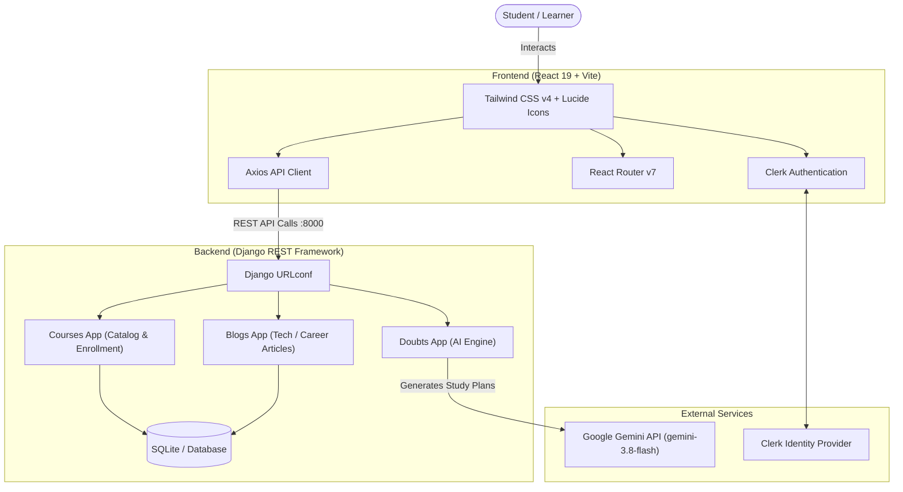

# 🎓 Learnix — Modern AI-Powered LMS Platform

<p align="center">
  
</p>

<p align="center">
  <b>Empowering Lifelong Learners with Structured Courses & Real-Time AI Doubt Assistance</b>
</p>

<p align="center">
  
  
  
  
  
  
  
</p>

---

## 📖 Overview

**Learnix** is a full-stack Learning Management System (LMS) built to provide modern learning experiences. It combines interactive course catalogs, educational articles, and an intelligent **AI Doubt Resolver** powered by **Google Gemini**. Students can explore courses, manage their learning path, browse curated tech & career articles, and receive actionable, structured study roadmaps when facing difficult concepts.

---

## ✨ Key Features

- 📚 **Comprehensive Course Catalog**: Browse detailed courses with instructor insights, student enrollment metrics, pricing, and media posters.
- 🤖 **AI Doubt Assistant ("Ask AI")**: Instant concept breakdown powered by Gemini AI. Delivers structured JSON step-by-step learning roadmaps with estimated completion times.
- 📝 **Curated Tech & Career Blogs**: Filter articles across *Tech*, *Non-Tech*, and *Job Search* categories to keep learners industry-ready.
- 🔐 **Clerk Authentication**: Secure sign-in and registration with modern user profile modals and session management.
- 🎯 **Student Dashboard**: Personalized view of enrolled courses and ongoing progress.
- 📱 **Responsive Glassmorphism UI**: Polished Tailwind CSS v4 styling featuring sticky desktop sidebars and intuitive mobile bottom navigation bars.
- ⚡ **RESTful Django Backend**: Clean REST API architecture with CORS configuration, modular serializers, and media upload handling.

---

## 🏗️ System Architecture



---

## 🛠️ Tech Stack

### Frontend
- **Framework**: React 19 (Vite 8)
- **Styling**: Tailwind CSS v4
- **Icons**: Lucide React
- **Routing**: React Router DOM v7
- **Authentication**: Clerk React (`@clerk/react`)
- **HTTP Client**: Axios

### Backend
- **Framework**: Django 6 & Django REST Framework (DRF)
- **CORS Management**: `django-cors-headers`
- **AI Integration**: Google GenAI SDK (`gemini-3.8-flash`)
- **Database**: SQLite (Development) / PostgreSQL-ready
- **Media Storage**: Django static & media uploads

---

## 📁 Project Structure

```text
Learnix/
├── backend/                       # Django Backend Project
│   ├── backend/                   # Core settings, WSGI, ASGI, root URLs
│   ├── courses/                   # Course models, serializers, views, routes
│   ├── blogs/                     # Blog models, categorization, serializers, routes
│   ├── doubts/                    # AI Doubt handling view & endpoint
│   ├── utils/                     # AI utility (askAi.py via Google GenAI)
│   ├── media/                     # Uploaded media (course & blog posters)
│   ├── manage.py                  # Django management CLI
│   └── .gitignore                 # Backend-specific ignore rules
│
├── frontend/                      # React 19 + Vite Client Application
│   ├── src/
│   │   ├── components/            # Reusable UI (NavBar, SideBar, CourseCard)
│   │   ├── pages/                 # Home, All Courses, My Courses, Doubts, Blogs
│   │   ├── services/              # Centralized Axios API services
│   │   ├── App.jsx                # Layout wrapper & mobile navigation
│   │   ├── Routing.jsx            # Application route definitions
│   │   └── main.jsx               # App entrypoint & Clerk Provider setup
│   ├── .env.example               # Frontend environment template
│   ├── package.json               # Dependencies & scripts
│   └── vite.config.js             # Vite configuration with Tailwind CSS v4
│
├── .gitignore                     # Repository-wide root gitignore
└── README.md                      # Project documentation
```

---

## 🚀 Getting Started

### Prerequisites
Make sure you have installed:
- **Node.js** (v18.0.0 or higher) and `npm`
- **Python** (v3.11 or higher)
- **Git**

---

### 1. Clone the Repository
```bash
git clone https://github.com/<your-username>/Learnix.git
cd Learnix
```

---

### 2. Backend Setup (Django)

1. **Navigate to the backend directory**:
   ```bash
   cd backend
   ```

2. **Create and activate a virtual environment**:
   - **Windows**:
     ```bash
     python -m venv ..\.venv
     ..\.venv\Scripts\activate
     ```
   - **macOS / Linux**:
     ```bash
     python3 -m venv ../.venv
     source ../.venv/bin/activate
     ```

3. **Install dependencies**:
   ```bash
   pip install django djangorestframework django-cors-headers google-genai pillow
   ```

4. **Set your environment variable for Gemini AI**:
   - **Windows (PowerShell)**:
     ```powershell
     $env:GEMINI_API_KEY="your_google_gemini_api_key_here"
     ```
   - **macOS / Linux**:
     ```bash
     export GEMINI_API_KEY="your_google_gemini_api_key_here"
     ```

5. **Apply Database Migrations**:
   ```bash
   python manage.py migrate
   ```

6. **Start the Django Development Server**:
   ```bash
   python manage.py runserver
   ```
   Backend will be running at: `http://localhost:8000/`

---

### 3. Frontend Setup (React + Vite)

1. **Open a new terminal and navigate to `frontend`**:
   ```bash
   cd frontend
   ```

2. **Install dependencies**:
   ```bash
   npm install
   ```

3. **Configure Environment Variables**:
   Copy `.env.example` to `.env`:
   ```bash
   cp .env.example .env
   ```
   Open `.env` and fill in your values:
   ```env
   VITE_CLERK_PUBLISHABLE_KEY=pk_test_your_clerk_key_here
   VITE_API_URL=http://localhost:8000
   VITE_APP_NAME=Learnix
   ```

4. **Start the Frontend Dev Server**:
   ```bash
   npm run dev
   ```
   Frontend will be running at: `http://localhost:5173/`

---

## 📡 API Reference

| Endpoint | Method | Description |
| :--- | :--- | :--- |
| `GET /api/courses/getcourses/` | `GET` | Retrieve list of all available courses |
| `GET /api/courses/getcourse/<id>/` | `GET` | Retrieve single course details by ID |
| `POST /api/courses/addcourse/` | `POST` | Create a new course (with title, description, price, poster) |
| `PUT /api/courses/updatecourse/<id>/` | `PUT` | Update existing course attributes |
| `DELETE /api/courses/deletecourse/<id>/` | `DELETE` | Remove a course |
| `GET /api/blogs/blogs/` | `GET` | Retrieve published blog posts |
| `GET /api/blogs/blogs/<id>/` | `GET` | Retrieve single blog post |
| `POST /api/blogs/addblogs/` | `POST` | Add a new blog article |
| `POST /api/doubts/ask/` | `POST` | Submit student question and receive AI Roadmap |
| `GET /admin/` | `GET` | Access Django administration dashboard |

---

## 🔒 Security Best Practices

- **Never commit `.env` files**: All secrets, database credentials, and API keys should remain strictly in `.env` files (pre-configured in `.gitignore`).
- **Use `.env.example`**: Store placeholders for team onboarding without revealing production keys.
- **Django `SECRET_KEY`**: Ensure `DEBUG = False` and set a secure environment variable for `SECRET_KEY` before deploying to production.

---

## 🤝 Contributing

Contributions make the open-source community an amazing place to learn and build!

1. Fork the Project
2. Create your Feature Branch (`git checkout -b feature/AmazingFeature`)
3. Commit your Changes (`git commit -m 'Add some AmazingFeature'`)
4. Push to the Branch (`git push origin feature/AmazingFeature`)
5. Open a Pull Request

---

## 📄 License

Distributed under the **MIT License**. See `LICENSE` for more information.

---

<p align="center">
  Built with ❤️ by <b>Anshuman Patidar</b> and contributors.
</p>
